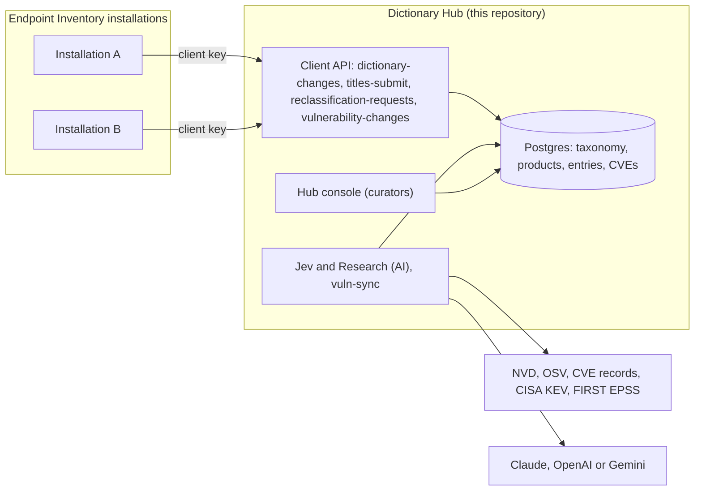

# Dictionary Hub

The shared server of **Endpoint Inventory**: it classifies software titles into categories, groups the spellings of
one product, and maps products to their known vulnerabilities (CVEs). One Hub serves many Endpoint Inventory
installations, so a title one installation reports is classified once, for all of them.

Client repository (the inventory app for Sophos Central): **<https://github.com/loardracoon/software-inventory-client>**.

> This is a personal project, not an official Sophos product or service. Use it for demos, labs and internal
> evaluation.

## Contents

- [What it does](#what-it-does)
- [Main features](#main-features)
- [How it works](#how-it-works)
- [Install](#install)
- [First steps after the install](#first-steps-after-the-install)
- [Connect Endpoint Inventory installations](#connect-endpoint-inventory-installations)
- [Day-to-day curation](#day-to-day-curation)
- [Update, back up, uninstall](#update-back-up-uninstall)
- [Rate limits and abuse protection](#rate-limits-and-abuse-protection)
- [Security and privacy](#security-and-privacy)
- [More documentation](#more-documentation)

## What it does

- **Dictionary**: every title an Endpoint Inventory installation finds (program, browser extension, IDE extension,
  package) gets a category of a two-level taxonomy (29 groups, 71 categories, for example "Remote access / Remote
  desktop and support") and an attention level (Info, Review, Not allowed).
- **Classification with AI**: *Jev* proposes a category for new titles (Claude, OpenAI or Gemini, your choice and
  your key); *Research* looks up hard titles on the web. Curators accept, change or reject the proposals.
- **Products**: "7-Zip 23.01 (x64)" and "7-Zip 26.05 (x64)" are one product; the classification belongs to the
  product, and a new spelling of a known product is classified at once.
- **Vulnerabilities**: each product is mapped to its NVD names (CPE) and its CVEs, with the affected version ranges
  and the operating system they apply to, plus CISA KEV (known exploited) and FIRST EPSS (exploit probability).
- **Client API**: the installations pull the dictionary and the CVE feed, send the titles the Hub does not know yet,
  and ask for reclassification. Each installation has its own key.

## Main features

| Area | Features |
| --- | --- |
| Inbox | Reclassification requests from the installations, new titles, Jev proposals, grouping conflicts, CPE matches to confirm |
| Dictionary | Products and their spellings, category and attention per product, revision history, move or split spellings, known vulnerabilities per product (CPEs, CVEs, KEV, EPSS, affected versions) |
| Classification runs | What Jev and Research did, with the probabilities, the model and the cost |
| Engines & usage | Jev and Research: mode (Off, Manual, Automatic), pause, provider and model, daily budget, cost this month |
| Taxonomy | The categories, their attention level and the Sophos Firewall category they map to |
| Clients | One key per Endpoint Inventory installation: create, rotate, revoke, last seen, sync position |
| Settings | Users and access (admin, operator, viewer; email and domain rules), AI provider keys, Data sources (NVD key, status of the CVE sync) |
| Email | Daily digest to the admins (new titles, open requests, new known exploited CVEs); notices for requests and engine pauses |
| Protection | Rate limits per address and per client key (one configuration file) |

## How it works



- Scheduled jobs (pg_cron) run Jev every hour (`:07`), Research every hour (`:37`), the CVE sync every hour (`:17`)
  and the digest every day (11:00 UTC). Jev and Research act alone only in Automatic mode.
- Only the server side (Edge Functions) calls the AI providers and the vulnerability sources. Provider keys are kept
  encrypted in the database (Vault) and never reach the browser.
- Built with React, TypeScript and Tailwind (Sophos Design System 2026 tokens) on self-hosted Supabase (Postgres 17,
  Auth, PostgREST, Edge Functions in Deno).

## Install

The simplest way is **one host with Docker**: one script installs everything with the images CI publishes (no build
and no login to a registry).

**Needs**: a Linux host with Docker Engine and Docker Compose 2.24 or later, `openssl` and `curl`; 2 vCPU and 4 GB
RAM. For HTTPS: a DNS name that points to the host, and ports 80 and 443 open. The installations must reach the Hub
address.

```bash
git clone https://github.com/loardracoon/software-inventory-hub.git
cd software-inventory-hub/deploy/compose

# HTTPS with Let's Encrypt, automatic updates every 15 minutes, daily database backup
sudo ./install.sh --domain hub.example.com --auto-update

# or, for a lab or a laptop (plain HTTP)
./install.sh --http-port 8080 --host <name or IP of this host>
```

| Option | What it does |
| --- | --- |
| `--domain NAME` | HTTPS on that name with a Let's Encrypt certificate |
| `--http-port N`, `--host NAME` | Plain HTTP on that port; the name used in links |
| `--smtp-host`, `--smtp-port`, `--smtp-user`, `--smtp-pass`, `--smtp-from` | Real email for the sign-in links and the admin email. Without them, the emails go to the built-in Mailpit at `/mail/` |
| `--tag SHA` | A specific build (default: the build deployed from `main`) |
| `--auto-update` | systemd timers for `update.sh` (every 15 minutes) and `backup.sh` (daily, 03:15) |

What `install.sh` does (it is safe to run again; it keeps the secrets it made):

1. Checks Docker, Compose, `openssl` and `curl`.
2. Writes `.env` (chmod 600): new random database password, JWT secret, cron secret and Mailpit password; the anon
   and service keys signed with that secret; the address; the image tag CI deployed on `main`.
3. Pulls the images, starts Postgres, sets the role passwords and the JWT secret, applies every migration, starts
   the services and waits until they are healthy.
4. Turns on the scheduled jobs (the Vault secrets `jev_url` and `cron_secret`).
5. With `--auto-update`: installs the timers `dictionary-hub-app-update` and `dictionary-hub-app-backup`.
6. Checks the Hub through Caddy and prints the next steps.

What runs: `db` (Postgres with pg_cron and Vault; the Vault key is kept in the `db-config` volume), `auth`, `rest`,
`functions`, `kong` (the console and API gateway), `mailpit`, and `caddy`, the only published service (HTTPS for a
domain, plain HTTP for `--http-port`).

Other ways to run it:

| Method | Guide |
| --- | --- |
| Kubernetes (K3S) with Argo CD (GitOps) | [deploy/k3s/README.md](deploy/k3s/README.md) |
| One host next to an existing mail server (the reference production) | [deploy/vps/README.md](deploy/vps/README.md) |
| Local development (Supabase CLI and Vite) | `npm ci`, `npx supabase start`, `npm run dev` (see [CLAUDE.md](CLAUDE.md)) |

## First steps after the install

1. **Sign in.** Open the address the script printed and enter your email. The **first account of an empty Hub
   becomes its admin**. Without SMTP, read the sign-in link in Mailpit at `https://<your host>/mail/` (user `mail`,
   password `MAIL_PASSWORD` in `deploy/compose/.env`).
2. **AI provider (optional, recommended).** In **Settings**, add a key for Claude, OpenAI or Gemini. In **Engines &
   usage**, choose the provider and model of Jev (and of Research), set the daily budget, and choose the mode:
   *Manual* (runs only when you click) or *Automatic* (the hourly job). Without a key, titles wait in the Inbox for a
   person.
3. **Vulnerability data (optional, recommended).** In **Settings › Data sources**, add a free NVD API key
   (<https://nvd.nist.gov/developers/request-an-api-key>). Without it, NVD allows 5 calls per 30 seconds, and the
   first full CVE sync takes hours instead of minutes. OSV, KEV and EPSS need no key.
4. **Users.** In **Settings › Users and access**, add curators by email with a role (admin, operator or viewer), or
   allow a whole domain as viewer or operator.
5. **Clients.** Create one key per Endpoint Inventory installation (next section).

## Connect Endpoint Inventory installations

1. In the Hub console, open **Clients › New client**, enter a name for the installation and a contact email, and
   copy the **client key**. The key is shown only once.
2. Give the installation's admin the Hub address (for example `https://hub.example.com`) and the key, over a safe
   channel.
3. In the installation: **Settings › Dictionary hub**, enter the **Hub URL** and the **Client key**, **Save
   connection**, then **Sync now**. The categories arrive at once, and the installation's unknown titles reach your
   **Inbox › New titles** (when its "Share unknown titles with the hub" switch is on).

On the Clients page you see when each installation was last seen and how far it has synced. **Rotate key** gives a
new key (the old one stops at once); **Revoke** stops a client and keeps its history. Each key may make 120 calls per
minute (`RL_HUB_CLIENT_REQUESTS_PER_MINUTE`).

What the installations send: the metadata of titles the Hub does not know (kind, source, match key, name, vendor,
description) and the OS families where each title is installed. They never send hostnames, users, tenant names,
installed versions, counts, or their policies; they compare their own versions with the CVE ranges.

## Day-to-day curation

- **Inbox**: answer reclassification **Requests** (accept, reject, with a note the installation sees), classify
  **New titles**, review Jev's **Proposals**, solve **Grouping review** conflicts, confirm or reject **CPE matches**
  (an exact match in the NVD dictionary is confirmed automatically; other candidates wait here).
- **Dictionary**: change the category or attention of a product, move a spelling to another product, see the
  product's CVEs and **Refresh** them.
- **Engines & usage**: watch the cost and pause an engine at any time.
- The **daily digest** email summarizes what waits.

## Update, back up, uninstall

All scripts are in `deploy/compose` and work from that folder:

| Script | What it does |
| --- | --- |
| `./update.sh` | `git pull`, then the image tag CI wrote into `deploy/k3s/app/stack.yaml`: pulls the images, applies new migrations, recreates what changed. `--tag <sha>` pins a build. With `--auto-update` a timer runs it every 15 minutes |
| `./backup.sh` | `backups/hub-<time>.dump` (all the data, including Auth, Vault and the jobs) and a copy of the Vault key `backups/pgsodium_root.key`; keeps the newest 14 (`KEEP=n`) |
| `./restore.sh <file>` | Stops the app services, restores the dump, starts them again (asks first; `--yes` to skip) |
| `./uninstall.sh` | Removes the containers and the timers, **keeps** the data, `.env` and `backups/` (`./install.sh` brings it back as it was) |
| `./uninstall.sh --purge` | Also deletes the database, the volumes, `.env` and the images; `--purge-backups` deletes `backups/` too. Asks you to type `delete` (`--yes` to skip) |

Copy `backups/` (with `.env`) off the host. The Vault secrets in a dump open only with that install's key: to
restore into a new host, install it, stop `db`, put `backups/pgsodium_root.key` in the `db-config` volume
(`/etc/postgresql-custom/pgsodium_root.key`, owner `postgres`), start `db`, then `./restore.sh`.

Day to day: `docker compose ps`, `docker compose logs -f kong functions`; change a setting in `.env` or
`rate-limits.env`, then `docker compose up -d`.

## Rate limits and abuse protection

All limits are in one file per deployment: `deploy/compose/rate-limits.env` (one host), `deploy/vps/rate-limits.env`
(next to a mail server) and `deploy/k3s/app/rate-limits.env` (K3S). They set the per-address limits of the gateway
(sign-in, API, functions, connections, body size), the per-address limits of Auth, the emails per hour, the
invitations per admin and the calls per client key.

| What | Variables (file `rate-limits.env`) | Recommended |
| --- | --- | --- |
| Sign-in links and code checks, for each address | `RL_AUTH_STRICT_RATE`, `RL_AUTH_STRICT_BURST` | `10r/m`, `10` |
| Other Auth calls, for each address | `RL_AUTH_RATE`, `RL_AUTH_BURST` | `120r/m`, `60` |
| Database API, for each address | `RL_REST_RATE`, `RL_REST_BURST` | `30r/s`, `120` |
| Edge Functions, for each address | `RL_FUNCTIONS_RATE`, `RL_FUNCTIONS_BURST` | `10r/s`, `60` |
| Open connections, for each address | `RL_CONN_PER_IP` | `60` |
| Largest request body | `RL_BODY_AUTH`, `RL_BODY_REST`, `RL_BODY_FUNCTIONS` | `64k`, `2m`, `10m` |
| Auth limits for each address (needs the header) | `GOTRUE_RATE_LIMIT_HEADER` and `_OTP`, `_VERIFY`, `_TOKEN_REFRESH` | `X-Real-IP`, `10`, `15`, `60` (in 5 minutes) |
| Emails from Auth, for the whole app | `GOTRUE_RATE_LIMIT_EMAIL_SENT` | `60` for each hour |
| Invitations for each admin | `RL_INVITES_PER_HOUR` | `20` for each hour |
| Calls for each client key | `RL_HUB_CLIENT_REQUESTS_PER_MINUTE` | `120` for each minute |

The numbers are for a team of up to about 50 users behind one office address. Every variable, with the reason and
when to change it, is in **[docs/rate-limits.md](docs/rate-limits.md)**.

## Security and privacy

- Provider keys, the NVD key and the job secrets are stored encrypted in the database (Vault), written by admins
  only and shown afterwards only as a hint.
- Client keys are stored as hashes; a key is shown once. Every client call is checked and counted.
- Unknown emails cannot create an account; the first account of an empty Hub is its admin.
- Row-level security on every table; changes of settings, users and the dictionary go to the audit log.
- Plain HTTP (`--http-port`) is for trusted networks only; use `--domain` for anything else.

## More documentation

| Document | Content |
| --- | --- |
| [docs/rate-limits.md](docs/rate-limits.md) | Each rate-limit variable: what it does, the recommended number, when to change it, how to check |
| [deploy/vps/README.md](deploy/vps/README.md) | The reference production host, jobs |
| [deploy/k3s/README.md](deploy/k3s/README.md) | Kubernetes (K3S) and Argo CD |
| [docs/phases/README.md](docs/phases/README.md) | Build history and follow-ups |
| [docs/phases/hub-H2-client-api.md](docs/phases/hub-H2-client-api.md) | The client API contract |
| [CLAUDE.md](CLAUDE.md) | Code conventions and rules for contributors |
| [Endpoint Inventory repository](https://github.com/loardracoon/software-inventory-client) | The client: inventory, policy, vulnerabilities per installed version |
